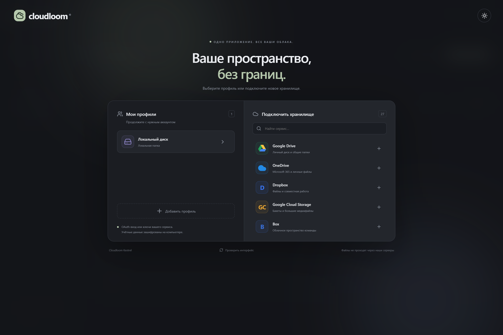
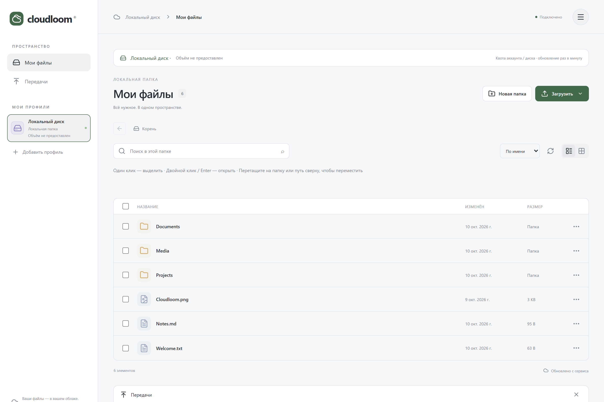

# Cloudloom Kestrel

A desktop file manager for multiple cloud accounts, with a profile picker, light/dark themes, real file/folder transfers and per-service setup help.




Screenshots show only a neutral local showcase folder, never connected cloud accounts, credentials or studio files.

## Download for Windows and Mac

See [Releases](https://github.com/prostoodin1/cloudloom-desktop/releases).

- [**Download Windows installer**](https://github.com/prostoodin1/cloudloom-desktop/releases/latest/download/Cloudloom_Kestrel_Windows_x64_Setup.exe) — Windows 10/11 x64, including WebView2 runtime setup when needed.
- [**Download Windows portable ZIP**](https://github.com/prostoodin1/cloudloom-desktop/releases/latest/download/Cloudloom_Kestrel_Windows_x64_Portable.zip) — extract all files, keep the resources folder and run cloudloom.exe. Requires WebView2 Runtime.
- [**Download Mac Intel DMG**](https://github.com/prostoodin1/cloudloom-desktop/releases/latest/download/Cloudloom_Kestrel_macOS_Intel.dmg) — Intel Macs (x86_64).
- [**Download Mac Apple Silicon DMG**](https://github.com/prostoodin1/cloudloom-desktop/releases/latest/download/Cloudloom_Kestrel_macOS_AppleSilicon.dmg) — M-series, ARM64, native build, no Rosetta required.
- ZIP application bundles and SHA256 checksums are also provided.

Requires **macOS 13 Ventura or later**. Open the DMG and copy Cloudloom into Applications.

These initial Mac builds are **ad-hoc signed, not Apple Developer ID signed or notarized**. They do not have Apple-verified publisher identity. macOS Gatekeeper may block downloaded copies. No instructions to disable system security are included. Developer ID signing/notarization requires the publisher's Apple Developer credentials and is not configured in this release.

## Features

- Signed automatic updates at startup, before opening the workspace. Offline/error fallback lets you continue with the installed version. **Older releases need one manual installation of Kestrel**; subsequent native releases can update automatically. Windows installation may require an OS prompt; macOS relaunches after installation. [Update behaviour and publishing](docs/UPDATES.md).

- Per-item **… → Получить ссылку** when the connected backend advertises public-link support. A confirmation dialog is required; opening a preview never creates a public link. Delivery user-API profiles create read-only links for exactly one selected file/folder, with a 1–90 day expiry (7 days by default), optional password and immediate revocation in the result dialog. Server permissions/password policies still apply. Other providers create/retrieve their normal link; password, expiry and revocation are not promised where the adapter does not provide them. Existing Delivery WebDAV profiles do not gain user-API sharing automatically.
- Video/audio streaming up to **50 GB (50,000,000,000 bytes)** via a random, revocable loopback URL and bounded-memory byte-range reads. No whole-file temporary copy and no public link is created. Closing the viewer cancels active requests; the URL also expires after 24 hours. Seeking requires the storage backend/server to support efficient ranged reads; Delivery responses that ignore/mismatch Range are rejected instead of downloading the entire file. Playback still consumes network traffic and provider egress charges, if applicable. System codecs/container support apply: not every MKV/AVI/HEVC file plays on every OS. Images/text keep the existing bounded temporary-preview/editor path.
- Windows engine/proxy tests and a local SFTPGo fixture do not substitute for testing every real cloud account or macOS WebKit playback.

- Single click selects; double-click or Enter opens profiles, services, folders and files. Ctrl/Cmd-click and checkboxes select multiple items. Internal drag-and-drop moves files/folders onto another folder or a breadcrumb/root within the current profile; Escape cancels. Existing names and self/descendant moves are rejected. Moves are not atomic batches; provider/network failures can leave partial results, which are reported. Local Explorer/Finder drops still upload; cross-profile moves and dragging out to the OS are not implemented.
- Account/disk used/total storage in the profile sidebar and active profile header, refreshed every minute. Unsupported quotas stay unknown; no recursive file scans or invented totals.
- Open files inside the app: streamed video/audio with seeking, images up to 1 GiB and a UTF-8 text editor up to 2 MiB with Save / Ctrl+S / Cmd+S. Images/text use a bounded temporary copy. System codecs determine playback support; unsupported formats can still be downloaded.
- Text saves replace the remote file, first checking its content against the opening snapshot, then verifying saved bytes. Unsaved-change prompts protect close actions. This is best-effort conflict detection, not an atomic provider lock; avoid simultaneous writers. HTML/SVG/code are displayed as plain text, never executed. Temporary previews are removed on close; abandoned cache files expire after 24 hours when another preview is opened (3 GiB cache cap).
- Centered profile selector: saved profiles left, searchable services right, blurred background.
- Small **Помощь** button after selecting a service: dedicated credential instructions without clearing the form.
- Actual folder browsing, file/folder upload/download, rename, confirmed deletion, multi-select, list/grid views and drag/drop.
- Bounded concurrent transfers, actual progress and cancellation. Interrupted transfers are labelled on restart; cross-restart resumption is not implemented.
- Configurations encrypted individually. The encryption password is held in **macOS Keychain**, or Windows Credential Manager on Windows. Tokens are not stored in browser localStorage.
- 27 service entries with individual setup guides: Google Drive, OneDrive, Dropbox, Google Cloud Storage, Box, pCloud, Yandex Disk, WebDAV, S3-compatible storage, MEGA, Koofr, HiDrive, Backblaze B2, Azure Blob Storage, Storj, Seafile, SFTP, local folders, Delivery, Nextcloud, ownCloud, Proton Drive, OpenDrive, Jottacloud, PikPak, Wasabi and Cloudflare R2. Some are named presets for the same WebDAV/S3 adapter. Proton Drive's adapter is beta.

Delivery accepts the ordinary HTTPS website address (including `/web/`), username and password through the SFTPGo user API, with optional HTTP 2FA code in advanced settings. No separate WebDAV endpoint or manual token is required for new profiles. The server must permit user API access and file operations. Old WebDAV profiles remain unchanged. Credentials are stored directly in the OS credential vault; total quota is unavailable through this adapter.

Nextcloud and classic ownCloud construct standard WebDAV URLs from website addresses; existing full endpoints still work. Spaces/nonstandard servers require their exact endpoint. Optional fields are in advanced settings. SFTP includes file pickers for checked known_hosts and SSH keys, without disabling server verification.

Access depends on account permissions and provider-specific credentials. Google Drive may require a personal Desktop OAuth client. App passwords and storage API keys remain required where the provider requires them. Each service's help explains setup and links to official documentation. Do not send passwords, keys or tokens in issue reports.

Existing destinations are rejected to avoid overwriting. Folder/prefix behaviour and operation costs depend on the provider. Cloud sign-in and large-transfer behaviour must still be checked with target accounts; no demo accounts or files are fabricated.

## Build on macOS

Install Node.js 22+, Rust stable and Xcode Command Line Tools, then:

```sh
npm ci
npm run prepare:engine
npm run lint
npm test
npm run build
cargo test --locked --manifest-path src-tauri/Cargo.toml --lib
npm run tauri build
```

Preparation downloads pinned rclone v1.75.2 for the host CPU and verifies its official archive SHA256. The application bundles the matching executable and MIT license. Build natively on the requested CPU: do not package an Intel rclone binary inside an ARM app or vice versa.

The GitHub workflow builds and tests independently on Intel and Apple Silicon runners, verifies packaged architectures and resource execution, and checks that the application stays running at startup. Runner smoke tests are not a substitute for user-interactive tests, real account consent or a Gatekeeper test after downloading the release.

Windows source builds require MSVC C++ Build Tools and WebView2. The same commands build Windows natively; use `npm run tauri build -- --bundles nsis` for the installer. CI checks installation, resources, engine execution, application startup and uninstallation on a clean Windows account.

The public Kestrel release includes Windows and both Mac variants and is not marked as a prerelease. Windows downloads are not Authenticode signed: SmartScreen may warn or block them. Release status does not remove operating-system security checks. See [release notes](docs/RELEASE.md) for verification scope and known limitations.

## Public repository

The current source contains no local profiles, OAuth credentials or private cloud addresses. The [Studio Red Barcelona copy](https://github.com/Studio-Red-Barcelona/cloudloom-desktop) starts from a clean source snapshot, without personal-repository history; it is intentionally not a GitHub fork. The original personal repository retains its previous history. Both releases distribute identical signed update packages using the personal repository as the canonical update channel. Public visibility does not grant an open-source license: the application's existing all-rights-reserved licensing is unchanged. Third-party components retain their respective licenses.

- Live presentation updates: instructions, service names/descriptions and welcome-screen text/accent colours update from a validated JSON catalogue without restarting the app or remounting the editor. Checks at startup, on returning to the window and every minute while visible; offline fallback. No remote executable code. New adapters/logic still need a native update. [Editing and publishing the live catalogue](docs/LIVE-UI.md).
